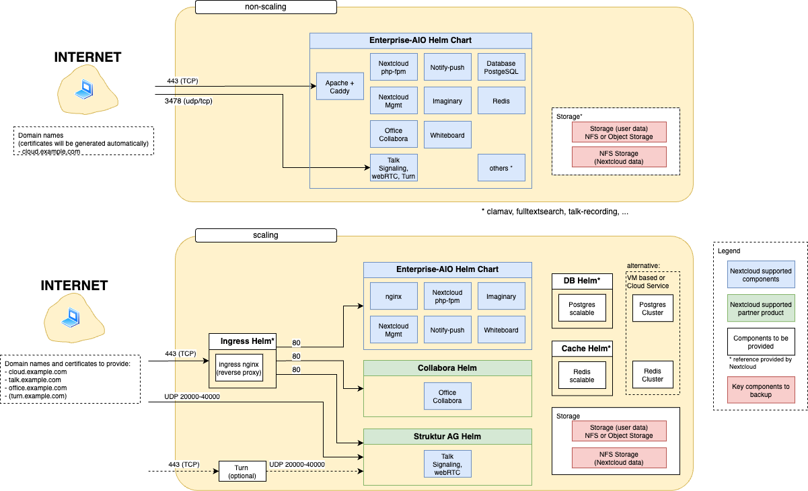

# Overview for Enterprise-AIO
Enterprise-AIO is built around Kubernetes for big instances that need to scale.

--- PREVIEW ---

## Comparison of E-AIO with other deployment methods
See [this table](https://cloud.nextcloud.com/s/Fd6bNdssWTELY5L)

## Architecture

## How to get access?
You can request access by sending us your GitHub username by submitting a ticket via https://portal.nextcloud.com or answering to the welcome mail. 
(E-AIO is a private GitHub repository and access is managed via GitHub).

## Documentation
After access to the repository is granted, documentation can be found here:
- [Project ReadMe on GitHub](https://github.com/nextcloud-gmbh/enterprise-aio#nextcloud-enterprise-deployment-for-kubernetes)
- [Helm Chart ReadMe on GitHub](https://github.com/nextcloud-gmbh/enterprise-aio/tree/main/nextcloud-enterprise-helm-chart#nextcloud-enterprise-helm-chart)
- [Values for the Helm Chart](https://github.com/nextcloud-gmbh/enterprise-aio/blob/main/nextcloud-enterprise-helm-chart/values.yaml)
- [Additional documentation on Nextcloud Portal](https://portal.nextcloud.com/categories/Scalability/Enterprise-AIO)
